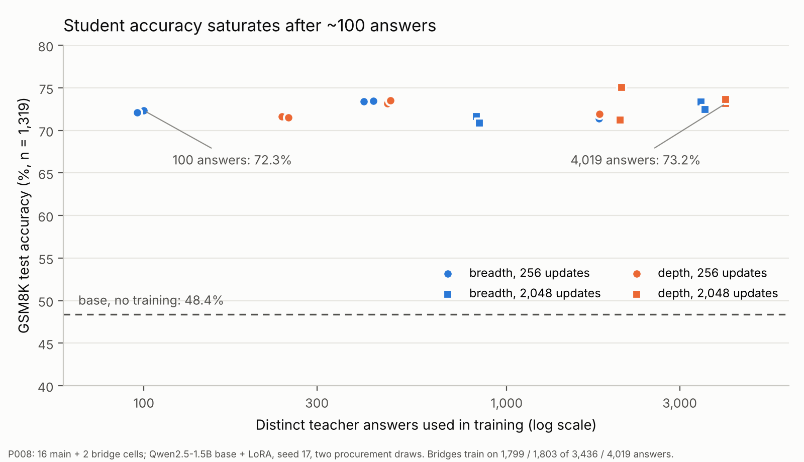

# P008 现状与判断（2026-10-14 凌晨，Claude 撰写，供 owner 与 GPT Pro 文献检索使用）

> 写给 owner（Tang Zhice）和协助找论文的 GPT Pro。
> 所有数字都来自已冻结、并经过独立复核（G3 PASS）的 P008 产物，以及本目录里的附加分析。
> 附加分析标为“探索性”，它们不在预注册方案里。

## 0. 一句话结论

在 **GSM8K + Qwen2.5-1.5B base + LoRA SFT** 这个设定下，学生只用约 100 个教师答案就到了 72% 左右，之后不管数据多 40 倍、训练步数多 8 倍，都停在 71–75%。

预注册的 breadth/depth 对比没有可重复的差异；唯一一个区间不含 0 的效应，在另一次采购 (draw) 里没有复现。

我们目前的判断是：**这个设定下，SFT 主要在教“答题格式/把已有能力说出来”，而不是教新的推理能力**。所以“预算怎么分配”几乎不影响结果。

接下来要做两件事：一是用两个便宜的探索性实验检验这个判断（见第 5 节）；二是重新选一个“数据真正起作用”的设定。

## 1. 原始研究问题

固定的采购预算下，蒸馏数学推理 SFT 数据时，钱应该花在买更多新题（breadth，每题 1 个可用解）上，还是给同一道题买更多经过验证的解（depth，每题最多 4 个）上？这个选择会不会随题目价格和预算规模而变？

- **计价方式**：每个 prompt token 和 completion token 记 1 个单位，失败和重复的尝试也收费。新题价格是 0 或 4m，其中 m = 373.34 单位，是先导实验里平均一次尝试的花费。
- **预算**：B1 = 211,257 单位（约 566 次尝试），B8 = 8 倍。
- **教师**：Qwen2.5-Math-1.5B-Instruct（vLLM）。**学生**：Qwen2.5-1.5B base + LoRA r16，seed 17。
- **训练剂量**：T1 = 256 步 / 524,287 个监督 token；T8 = 2,048 步。主路径上 B 和 T 一起放大（B1↔T1，B8↔T8）。
- **每题最多 8 次尝试**。breadth 拿到 1 个可用解就停，depth 拿到 4 个才停。
- **评测**：GSM8K 官方 test 1,319 题，greedy 解码，最多 512 个新 token，用冻结的 marked_answer_v1 解析器，被长度截断的输出算错。
- **两次独立采购 (draw) D1/D2**：每个 draw 独立打乱题目顺序、独立抽取教师随机流。同一 draw 内，各格子共享题目顺序和教师输出（common random numbers）。

## 2. 结果（16 个主格子 + 2 个 bridge + base）

| draw | 预算 | 题价 | 策略 | 买的题 | 可用答案 | 答对/1319 | 准确率 |
|---|---|---|---|---:|---:|---:|---:|
| D1 | B1 | 0 | breadth | 439 | 429 | 969 | 73.5% |
| D1 | B1 | 0 | depth | 124 | 469 | 965 | 73.2% |
| D1 | B1 | 4m | breadth | 102 | 100 | 954 | 72.3% |
| D1 | B1 | 4m | depth | 63 | 240 | 945 | 71.6% |
| D1 | B8 | 0 | breadth | 3,524 | 3,436 | 967 | 73.3% |
| D1 | B8 | 0 | depth | 1,043 | 4,019 | 965 | 73.2% |
| D1 | B8 | 4m | breadth | 846 | 826 | 945 | 71.6% |
| D1 | B8 | 4m | depth | 537 | 2,055 | 939 | 71.2% |
| D2 | B1 | 0 | breadth | 415 | 404 | 968 | 73.4% |
| D2 | B1 | 0 | depth | 124 | 479 | 970 | 73.5% |
| D2 | B1 | 4m | breadth | 96 | 96 | 951 | 72.1% |
| D2 | B1 | 4m | depth | 64 | 250 | 943 | 71.5% |
| D2 | B8 | 0 | breadth | 3,591 | 3,517 | 956 | 72.5% |
| D2 | B8 | 0 | depth | 1,039 | 4,014 | 971 | 73.6% |
| D2 | B8 | 4m | breadth | 860 | 841 | 935 | 70.9% |
| D2 | B8 | 4m | depth | 544 | 2,077 | 990 | 75.1% |

- **base**（不训练）：638/1319 = 48.4%。这是 zero-shot 加严格格式解析的结果。
- **bridge**（D1、B8、p0，只训 T1）：breadth 942，depth 949。T1 训不完 B8 的数据，各有 1,637 和 2,216 个答案一次都没训练到。
- **depth − breadth（百分点）**：D1 依次为 −0.30 / −0.68 / −0.15 / −0.45，D2 依次为 +0.15 / −0.61 / +1.14 / **+4.17**。
- **注册的 31 个对比里，27 个的 95% 配对 bootstrap 区间含 0。** 不含 0 的 4 个全部来自 D2 B8/4m 这一对模型，彼此不独立：Δ = +4.17 [+1.82, +6.52]，而 D1 同一格是 −0.45 [−2.88, +1.90]。所以**不能声称有效应**。
- **P007B（更早的独立实验，同一个教师和学生）**：价格交互是 +1.44 [−0.95, +3.87]。seed 17 看到的排序，换成 seed 23 就没有了。

## 3. 主要观察和判断

### 3.1 学生很快饱和（最可靠的发现）
- 只用 100 个答案（D1 B1/4m breadth）就是 72.3%，96 个答案（D2）是 72.1%。用 4,019 个答案、训练 2,048 步，是 73.2%。
- 外部参照：[Qwen2.5 技术报告](https://arxiv.org/pdf/2412.15115)里，Qwen2.5-1.5B **base 的 4-shot GSM8K 是 68.5%**，官方 Instruct 是 **73.2%**。
- 我们的学生基本就是“把 base 调到 Instruct 水平”。从 48.4% 到 72% 的提升，大部分很可能是格式和激发 (elicitation) 带来的，而不是学到了新的推理能力。实验 1 会直接检验这一点。

### 3.2 75% 不是“难题墙”，而是“答得不稳”
18 个学生在 1,319 题上的表现：
- 18 个都对的题有 514 道（39%）；18 个都错的题有 67 道（5.1%）；738 道题有的模型对、有的模型错。
- 只要 18 个里有一个答对就算对，覆盖率是 94.9%。
- 8 个 T8 学生投票取多数答案，准确率是 **81.6%**；8 个里有一个答对就算对，是 92.7%。单个学生是 71–75%。（这是 8 个不同模型的集成，不是同一个模型的自洽性。）
- 每个模型的输出被长度截断的有 36–56 道（约 3–4 个百分点），都算错。

### 3.3 预算浪费在“坏题”上，固定 8 次上限会放大这种浪费
D1 B8/p0 breadth 共买了 3,524 道题。第 k 次尝试的条件成功率如下：

| 第 k 次 | 第 1 次 | 第 2 次 | 第 3 次 | 第 4 次 | 第 5–8 次 |
|---|---:|---:|---:|---:|---:|
| 前面全失败时，这次成功的概率 | 95.2% | 28.4% | 8.3% | 8.1% | 约 2–5% |

- 87 道题（2.5%）试满 8 次都没成功，吃掉了 696 次尝试，占这个格子 **16.2% 的预算**。
- 其中 70 道，教师 8 次里至少 7 次给出**同一个**答案。我逐题判断的结果（AI 判断，见 `train_consistent_wrong_70.csv`）：**标准答案错了 17 道**，**题目有歧义或本身有缺陷 33 道**，只是格式不同（例如 25 和 1/4）2 道，教师真的做错 18 道（这个数偏保守）。
- 测试集里 18 个学生全错的 67 道题：标准答案错了 4 道（例如 test/00454：参考解写的是 4+1，正确答案应是 240），有歧义 8 道，解析失败 1 道，学生真的做错 54 道（见 `test_all18_wrong_67.csv`）。测试集坏题只占 1,319 题的约 1%，不是 75% 上限的主因。
- 已有工作指出 GSM8K 有标注错误，见 [Vendrow et al. 2025, GSM8K-Platinum](https://arxiv.org/pdf/2502.03461)。

### 3.4 关于“多次重复”的方差
Owner 指出，种子和数据带来的方差是常识，不能算贡献。我们同意。它只作为方法上的要求：任何分配结论都必须跨多个 draw 和种子重复验证。

## 4. 我们的过程失误（如实记录）
- 2026-10-13 下午，T1 的 8 个结果出来时，表里已经能看到“只用 100 个答案 ≈ 用 429 个答案”，这是饱和的信号。审计方（Claude）当时只核对了数字是否正确，**没有向 owner 报告“继续加预算和训练步数很可能没用”**。之后又花了约 $60–70 跑了 8 个 T8。
- 改进：今后每次审结果都附一段“科学信号检查”。只要多花的预算或训练步数没有带来提升，先报告 owner，再决定下一步花钱。
- 写这份说明时的花费：P008 有标签的平台计量约 $136.70，整个工作区的延迟计量是 $224.36（不是发票）。项目上限是 $450。

## 5. 正在申请的两个探索性实验（非预注册，上限 $30，需 owner 直接在 Codex 批准）
1. **只评测，不训练**：(a) Qwen2.5-1.5B base，4-shot，示例取自 P008 预留的 dev 题；(b) 官方 Qwen2.5-1.5B-Instruct，zero-shot。两者都用同一个冻结解析器评 1,319 题。预期：如果 (a) 接近 65–70%，“SFT 主要教格式”就基本坐实；(b) 给出同一个 base 的参考上限。
2. **用错误答案训练**：用约 429 个“完整、未截断、能解析、但答案错误”的 D1 教师输出，按 d1_b1_p0_breadth_t1 的同样剂量训练一个学生，对照组是 969。混杂因素：错误输出集中在难题和坏题上。

## 6. 候选的后续方向（待读完文献再定）
- **A. 换到“数据真正起作用”的设定**：任务换成 MATH 3–5 级或其他更难的题，学生换成数学先验较弱的非 Qwen 模型（例如 Llama-3.2-1B、OLMo-2-1B），让学生离天花板远、教师失败率更高。
- **B. 稳定性**：既然多数投票能到 81.6%，就研究预算花在哪里最能提高单个模型答题的稳定性，比如 self-consistency 蒸馏、多解训练对方差的影响。
- **C. 验证和数据质量的成本**：如果错误答案几乎不伤害学生，“花钱验证答案对错”值不值？还有标注一致性筛查、提前放弃规则、把难题升级给更强的教师（escalation），以及用参考解引导教师写推理（STaR 式 rationalization）。
- 无论选哪个方向：题价都要做成一条曲线（price sweep），不只比两个点；而且必须跨多个 draw 和种子。

## 7. Literature search brief (for GPT Pro)
Context: SFT distillation of math reasoning (GSM8K) into Qwen2.5-1.5B base saturates at about 72% after about 100 teacher demonstrations (base 4-shot 68.5%, Instruct 73.2%). Coverage-vs-depth allocation under a token-cost tariff shows no replicable effect. Failures concentrate on mislabeled or ambiguous problems. An ensemble majority vote reaches 81.6%. Please find recent (2024–2026) work on:
1. **SFT as format/elicitation vs capability**: superficial alignment (LIMA and follow-ups), sample-efficiency of reasoning SFT, "how few examples are needed", and evidence that teaches-format results are specific to model families (especially Qwen math priors and contamination).
2. **Wrong or noisy demonstrations in SFT/distillation**: "structure not content" (Li et al. 2025), training on incorrect CoT, label noise in math SFT, and spurious-reward results in RLVR (Shao et al. 2025) together with their model-family dependence.
3. **Cost-aware data acquisition for reasoning**: compute-optimal sampling (weaker-but-cheaper generators), problem-vs-solution allocation (OpenMathInstruct-2, "When Does Generating More Help?"), difficulty-aware rejection sampling (DART-Math), adaptive per-problem sampling budgets, early-abandon rules.
4. **Benchmark and label noise in GSM8K and MATH** (GSM8K-Platinum and successors) and consistency-based label-error detection.
5. **Reliability vs capability**: pass@k vs pass@1 gaps, self-consistency distillation, variance across fine-tuning runs and data orders, and whether multi-solution training reduces answer instability.
6. **Settings where data allocation demonstrably matters**: harder benchmarks or weaker students where SFT scaling is not saturated, and recommended student/task pairs for small-budget academic studies (≤ $500 GPU).

## 本目录文件
- `saturation.png`：饱和图，由冻结的 `registered_primary_results_v1/ALL_CELLS.csv` 绘制。
- `train_consistent_wrong_70.csv`、`test_all18_wrong_67.csv`：可疑题的逐题分类（Claude 的判断，需要人工抽查）。
