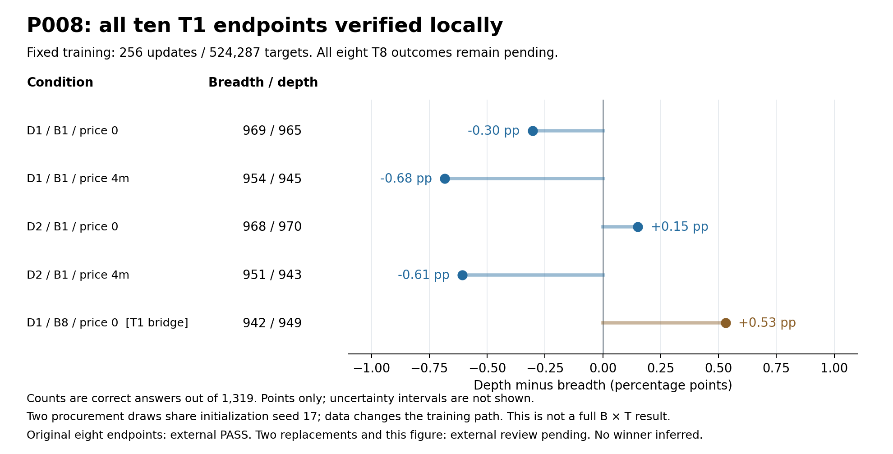

# P008 T1结果与局限（全设计尚未完成）

2026年10月13日16:36PDT，本地完整核验完成：10项T1共13,190条终点评测、2,560次更新、5,242,870监督token及10份完整state全部通过；所有GPU已退出，正式终点技术unknown为0。原8项已获Claude62fb9c5b独立外审PASS；最新两项补跑和本图仍待外审。base638/1319已获外审PASS。

| 采购 | 采购预算 | 题价 | 多题正确/1319 | 多解正确/1319 | 多解−多题（pp） | 长度上限计错（多题/多解） |
|---|---|---|---:|---:|---:|---:|
| D1 | B1 | 0 | 969 | 965 | −0.3033 | 42 / 43 |
| D1 | B1 | 4m | 954 | 945 | −0.6823 | 39 / 36 |
| D2 | B1 | 0 | 968 | 970 | +0.1516 | 41 / 35 |
| D2 | B1 | 4m | 951 | 943 | −0.6065 | 40 / 39 |
| D1 | B8，T1桥接 | 0 | 942 | 949 | +0.5307 | 43 / 49 |

每项训练固定256更新/524287监督token。这张图只展示点估计，没有置信区间。B1下，零题价的排序随采购draw改变，高题价两draw点估计均略偏多题；这不能确立稳定赢家、等效或题价阈值。不能用逐格Wilson区间是否重叠代替配对差值检验。

B8/T1桥接只支持固定低训练量下的条件比较。8项T8尚未运行，不能报告B1到B8联合扩量的完整效果，也没有完整B×T交互。两draw共用初始化seed17，语料变化会改变训练路径；draw差异不等于纯采购方差。只有2次采购，不能给出精确采购总体不确定性。

每格是相同假设token计价cap，实际消耗、余额、可用答案、失败重复与曝光不同，不称等实际美元支出。完整报告仍须逐格披露这些量。研究者九月已见1319题测试集，final-answer正确不保证推理正确；冻结解析器和长度上限计错规则不变，任何后验格式敏感性只能补充列示。

两原D1 B1零价调用训练前失败（0更新/0输出），独立补跑在16:23/16:28PDT实际完成，原failed记录与费用保留。最新两项分别独立核验892文件SHA、全1319raw和完整state。depth本地CLI连接重置并不代表云失败：原result/terminal已正常返回，0新重发/0回执恢复调用。原8项DNS断连后的只读收集来源与一次collector有限修复仍完整保留。

全部10T1+base真实计时已代入冻结C1/C2规则：含20%余量的8项T8预测9550.78–9551.68秒，高于9530秒准入线，因此N2当前未通过，不能派发T8。原9560秒worker帽未变。新9600秒/$0.40有界修订只是提案，须owner及确切审计后才能采用。

16:36PDT平台延迟计量为$162.31184746，billed$0；其中月报P008标签$74.31044653。P008当前已授权上限/预留仍$266.04，不是花费。残余计量加完整P008预留$354.04140093，低于项目$450上限；失败/setup/build/storage均计，至少$50保护不变。这不是发票、余额或历史所有平台终身费用。

21PDT材料冻结照常，P007B完整事实、图表及局限已齐备；P008未完成项目标pending，后续核验结果另列。最终slides与个人解释由研究者完成。

[原8项证据](student_t1_eight_v1/REVIEW_REQUEST.md) · [两项补跑证据](student_t1_replacements_v1/REVIEW_REQUEST.md) · [实际计时待审](t8_actual_timing_proposal_v1/REVIEW_REQUEST.md) · [有界工程修订提案](t8_cap_amendment_proposal_v1/PROPOSAL.md) · [P007B证据](../sft_allocation_midpoint_20261011/P007B_MIDPOINT_EVIDENCE.md)
