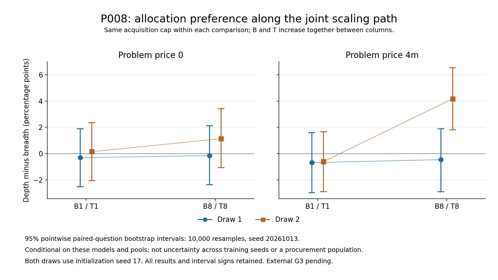

# P008 result review — supplement after the 21:00 PDT material cutoff

This supplement records a review received after the cutoff. It does not alter the frozen material snapshot, original data, registered analysis, plots or primary scoring.

All 18 students and the base model completed local raw-output, dose and state verification. Claude has now accepted all eight T8 results and the complete registered 19-model / 31-contrast tables and all three figures at the fixed original result commit. Final CPU integrity verification is still pending; external review of public state hashes does not mean the reviewer read the private binaries.

## The high-budget, nonzero-price difference appears in D2 only

At B8/T8 with price 4m, depth minus breadth is +4.17 percentage points in D2, with a pointwise conditional paired-question 95% interval of [+1.82, +6.52]. In D1, the corresponding estimate is −0.45 points, interval [−2.88, +1.90]. The positive pattern was not replicated across the two draws. D1's interval containing zero does not establish equality.

| Published contrast | D1 estimate and interval, pp | D2 estimate and interval, pp |
|---|---:|---:|
| Depth minus breadth, B8 / price4m | −0.45 [−2.88, +1.90] | +4.17 [+1.82, +6.52] |
| Change in that policy gap from B1/T1 to B8/T8 | +0.23 [−3.18, +3.56] | +4.78 [+1.52, +8.11] |

The figure is the original published image. Its D2 B8/price4m difference is a single-draw observation, not an established policy advantage. With two acquisitions and one shared initialization seed, the uncertainty intervals condition on these fixed models and the observed benchmark; they do not estimate training-seed or procurement-population uncertainty. Data also changes the training path, so draw variation is not pure procurement variance.

Of 31 reported pointwise intervals, 27 include zero. The four exclusions concern D2's B8/price4m policy gap, its joint-scaling change, and the two draw means derived from the same models. Those draw means are not independent evidence. No familywise or multiplicity-adjusted significance claim is made, and no calibrated probability of 'chance discovery' is available here.

The four D1/p0 bridge contrasts all include zero. They remain descriptive conditional comparisons; missing B1/T8 corners prevent identification of a complete budget-by-training interaction. No stable winner, equivalence, or general price threshold follows from this finite design.

## Evidence and remaining scope

- Original complete result: [tables, all plots and limits](../registered_primary_results_v1/FACTS_AND_LIMITS.md).
- Original cutoff material: [immutable 21:00 PDT snapshot](../midpoint_freeze_20261013_2100PDT_v1/READINESS.md).
- Actual external acceptance and scope: [review disposition](../review_8aada22d_accepted_v1/DISPOSITION.md).
- The original N2 timing failure and owner-approved post-hoc 9600-second engineering amendment remain disclosed. Failed physical parents and their costs remain retained.
- The secondary uniform parser sensitivity remains pending under the protocol; no selected-case correction changes the frozen primary results.
- Final CPU numeric review, its original finite execution and local proof verification remain pending. This addendum's wording awaits its own review.

No model call, raw oracle, bootstrap or image generation was repeated to write this supplement. The saved billing remains a dated delayed meter, not an invoice or balance.
