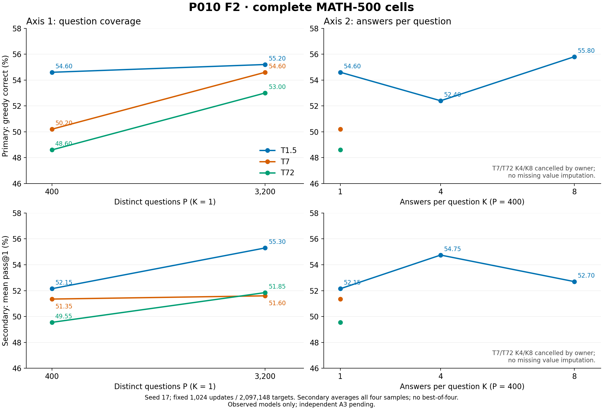

# Original figures with required captions

## F1 — P008: 不是受控的数据规模曲线

Original PNG bytes are reused. Procurement and training vary jointly; the existing conditional bridge does not establish the full interaction. Original source and table hashes are bound in the trace. No new plot or bootstrap was produced.

## F2 — Original three-teacher axes

Original PNG/PDF bytes and prior visual-check record are copied unchanged. Cancelled T7/T72 K4/K8 cells remain unavailable. Seed29 is in separate saved tables.
